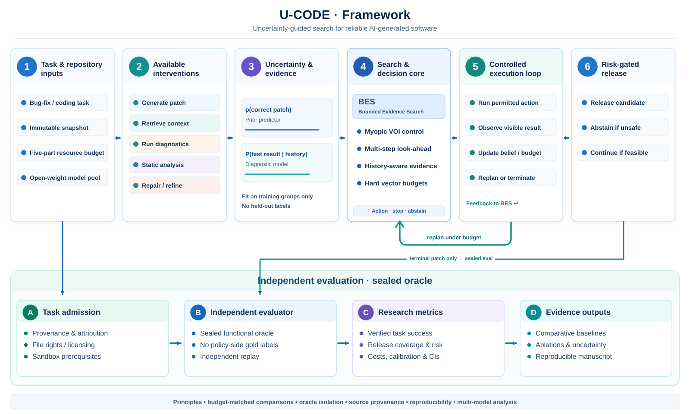

# U-CODE

**Uncertainty-Guided Search for Reliable AI-Generated Software**

> Research-stage framework. No effectiveness claims, completed model experiments, or verified 120-repository corpus are asserted.

U-CODE studies **when a software engineering agent should test, retrieve context, generate another patch, repair, or abstain** under a fixed execution and inference budget. The target is the Springer *Automated Software Engineering* special issue **Search-Based Software Engineering in the Era of LLMs and Agentic Systems** (30 January 2027): https://link.springer.com/collections/jjcfecffai.

## Framework at a glance



<sub>Figure 1. Proposed U-CODE architecture. The top row is the risk-aware agent policy (task → interventions → evidence modeling → BES → controlled execution → release/abstention); the curved teal arrow returns **visible** execution feedback from the execution stage to BES. The lower research lane independently admits tasks, seals the functional oracle, evaluates released artifacts, and summarizes evidence. **Architectural design, not a completed or validated experimental result.** [View scalable SVG](docs/figures/ucode-framework.svg).</sub>

## Six LLMs selected for the planned study (25 October 2026)

All six recommended models have been **accepted by the researcher for the U-CODE study plan**. The [version-controlled six-model configuration](configs/accepted_six_model_study_2026-10-25.json), [model preflight code](src/ucode/model_readiness.py), and [experiment/reproducibility protocol](docs/SIX_MODEL_STUDY_PLAN_2026-10-25.md) preserve every checkpoint—none is silently excluded for being larger or gated.

| Selected model | Research role | Current status |
|---|---|---|
| [Qwen2.5-Coder-7B-Instruct](https://huggingface.co/Qwen/Qwen2.5-Coder-7B-Instruct) | Local-feasibility coding baseline | Planning selected; no pinned weights |
| [Qwen3-Coder-30B-A3B-Instruct](https://huggingface.co/Qwen/Qwen3-Coder-30B-A3B-Instruct) | Larger mixture-of-experts coding agent | Planning selected; high-memory gate |
| [Devstral Small 2 24B](https://huggingface.co/mistralai/Devstral-Small-2-24B-Instruct-2512) | Repository-agent specialist | Planning selected; runtime/memory gate |
| [DeepSeek-Coder-V2-Lite-Instruct](https://huggingface.co/deepseek-ai/DeepSeek-Coder-V2-Lite-Instruct) | Independent code-specialist publisher | Planning selected; model-license/security gate |
| [CodeGemma 1.1 7B IT](https://huggingface.co/google/codegemma-1.1-7b-it) | Smaller code-specific control | Planning selected; gated terms/access |
| [Llama 3.1 8B Instruct](https://huggingface.co/meta-llama/Llama-3.1-8B-Instruct) | General-instruct control | Planning selected; gated terms/access |

**Planning approval is not provider authorization or a benchmark result.** All six currently fail the inference-readiness gate until their provider terms, full model/tokenizer revisions, weights, compatible execution environment, memory profile, and sandbox have been verified. We will compare **six checkpoints from five publisher families**. No inference, paid GPU, or independently verified repository task run has been performed.

## Current status (25 October 2026, all ten PR screening positions per language)

- **120 discovery candidates across 12 GitHub primary-language search categories**, each with a PR link returned for `author:copilot-swe-agent[bot] is:pr is:merged`. **These are NOT 120 verified AI-generated repositories.** GitHub bot attribution alone does not establish what fraction of source code is AI-authored.
- Public dataset leads: [AIDev](https://huggingface.co/datasets/hao-li/AIDev), [SWE-chat](https://huggingface.co/datasets/SALT-NLP/SWE-chat) (gated), [DroidCollection](https://huggingface.co/datasets/project-droid/DroidCollection), [SWE-rebench](https://proceedings.mlr.press/v306/badertdinov26a.html), [EffiBench-X](https://huggingface.co/datasets/EffiBench/effibench-x). They have **distinct units of analysis** and must not be naively merged.
- **Issue #1 completed discovery metadata screen:** **120/120 links attempted, 119/120 PRs retrieved**, with **1 GitHub 404 retrieval failure** (candidate #26). Among the 119 retrieved: **62** production-source-path *candidates*, **10** test-only, **45** non-source, and **2** empty-file-list cases requiring review. **62** have recognized repository-level SPDX metadata; **12** forks; **zero fully eligible executable tasks** pending independently verified AI-line attribution, file rights and sealed independent functional oracles. These 62 are weak path-level hints, **not 62 verified AI-generated patches**. [Full 120-link research ledger](docs/logs/2026-10-25_complete_120_pr_screen.md) · [Initial 24-PR evidence](docs/logs/2026-10-24_issue1_stratified_pr_audit.md) · [Third-entry screening](docs/logs/2026-10-24_issue1_second_stratified_batch.md) · [Fourth-entry screening](docs/logs/2026-10-24_issue1_fourth_stratified_batch.md) · [Fifth-entry screening](docs/logs/2026-10-24_issue1_fifth_stratified_batch.md) · [Sixth-entry screening](docs/logs/2026-10-24_issue1_sixth_stratified_batch.md) · [Seventh-entry screening and .NET generated-artifact correction](docs/logs/2026-10-24_issue1_seventh_stratified_batch.md). GitHub discovery language is not necessarily the changed-source language. [Latest source-only manual review queue](scripts/triage_review_queue.py) scores **62** path candidates but admits **none** without independent review.
- The project initially offers a **pure-Python research scaffold** and **offline toy environment**, not a trained/calibrated uncertainty model or model-driven code repair engine.

## Scientific novelty and mathematical formulation (24 October 2026)

**Reviewed close competitors:** 24 primary-source links and potential baseline threats
in [the dated novelty matrix](literature/novelty_matrix_2026-10-24.csv).
Key comparison papers include SWE-Search (MCTS), GA4GC (multiobjective
configuration search), SWE-Replay (trajectory reuse), SWE-Verifier (2026-10-21
selective action verification) and work finding negative effects of
uncertainty-only regeneration. None of these concepts can be claimed
individually as a first.

**Refined U-CODE question:** can independent calibration and resource-aware
evidence acquisition determine when to test, statically analyze, retrieve,
generate, repair or abstain, improving *released* patch reliability
against equal-budget search without calibrated uncertainty?

The [formal methods and novelty/falsification memo](docs/FORMAL_PROBLEM_AND_NOVELTY_2026-10-24.md)
defines a partially observed decision process, the five-resource budget vector,
full-task independent verified success, selective wrong-release risk, coverage
constraints, Bayesian value of diagnostic evidence, and exactly what would
falsify the method. A strict posterior acceptance gate can even make signed
diagnostic evidence value negative; this is a **mathematical reference
counterexample**, not a measured study result.

**Algorithmic prototypes:** `src/ucode/voi.py` provides an analytically
testable one-step binary diagnostic value benchmark; `acquisition.py`
applies candidate-generation EHVI only to `generate` and `repair` actions.
`test` / `retrieve` / `static_analysis` do **not** manufacture new
candidate points. These two prototypes are **not integrated into a learned,
fully tested search controller** and are not empirically validated.

**Manuscript:** [paper/overleaf/main.tex](paper/overleaf/main.tex)
now has properly separated objectives, resource-constrained Bellman/EVSI
formulations, 16 source-linked BibTeX entries, and no fabricated results.
The official Springer publisher class is still required for a real compile.

## Version-controlled Springer/Overleaf workflow (updated 2026-10-24)

- **Directly updated GitHub sources:** [paper/overleaf/main.tex](paper/overleaf/main.tex)
  and [paper/overleaf/references.bib](paper/overleaf/references.bib).
- **New honest methodological reference:** [src/ucode/vector_policy.py](src/ucode/vector_policy.py)
  checks five independent resource budgets and compares modeled diagnostic
  evidence against generation/repair forecasts on one terminal-value scale.
  These forecasts are *hypothetical*, not fitted performance results.
- **Safe manuscript export:** `python -m scripts.export_overleaf --output
  dist/UCODE_Overleaf_sources.zip` creates a checksum-verified, deterministic
  paper-only ZIP. The CI workflow attaches that ZIP as an artifact named
  `ucode-overleaf-sources` on successful runs.
- **Live Overleaf is NOT directly connected.** The bundle is for importing into
  the [official Springer Nature template](https://www.overleaf.com/latex/templates/springer-nature-latex-template/myxmhdsbzkyd);
  the publisher class is intentionally not included. Overleaf Git/GitHub
  sync is a separate authenticated user-side operation.
  [Details](paper/overleaf/README.md).

## Next evidence gates: task admission and training-only diagnostic fitting

- [Diagnostic training interface](src/ucode/diagnostic_fit.py):
  binary sensitivity and specificity are estimated **only from labeled training
  repository/fork groups** with pre-oracle observation times, explicit model
  IDs and frozen input fingerprints. Validation/evaluation groups, duplicated
  task IDs and mixed model/action records fail closed. A trained diagnostic
  likelihood does NOT by itself supply a calibrated prior or a risk guarantee.
- [Task admissibility contract](src/ucode/task_gate.py): checks immutable
  revision identifiers, production-file language, declared file-rights and
  independent-oracle review references, pinned image digest and secure
  sandbox policy. Its positive status means **declared complete, needs human
  verification**, never safe or rights-cleared by automation.
- [Scientific procedure](docs/CALIBRATION_AND_TASK_ADMISSION_PROTOCOL_2026-10-24.md):
  split, leakage, selection bias, statistical limitations and go/no-go criteria.
- [Two-PR deep provenance case ledger](data/audits/2026-10-24/two_pr_commit_and_license_deep_check.jsonl):
  dependabot-core #16665 has human-authored commits with Copilot co-author
  trailers, whereas onnx-light-cpu #1005 has Copilot-authored commits with
  human co-author trailers on two commits. PR-level Copilot accounts are
  **not** precise AI line-authorship annotations. Both candidates have
  production-source changes and root LICENSE files, but are **not** admitted
  or independently executed.
- The Springer source in [paper/overleaf/main.tex](paper/overleaf/main.tex)
  now reflects both the training-only equations and the observed
  human/agent commit-metadata ambiguity. CI continues to generate the
  **ucode-overleaf-sources** source-only artifact; no direct Overleaf-account
  write is claimed.

## Deep Research continuation — 2026-10-24

The [dated Deep Research synthesis](docs/DEEP_RESEARCH_SYNTHESIS_2026-10-24.md)
reconciles new papers and model/dataset leads with the **canonical 84-PR
screening checkpoint**. The older 24-PR stratified screen is an initial
subset, not the total screened count. No naturalistic source is fully
oracle-qualified yet.

**Manuscript:** [Springer/Overleaf main.tex](paper/overleaf/main.tex)
has a stronger citation-grounded related-work and novelty-falsifier
section, plus a prospective matched-task evaluation subsection.
[references.bib](paper/overleaf/references.bib) includes recent 2026
verification papers, correctly marked as preprints.
[Novelty matrix](literature/novelty_matrix_2026-10-24.csv) currently
includes 24 source-linked comparisons, not an exhaustive systematic review.

**Reproducible pilot inputs:** [model candidates v2](configs/models_v2_2026-10-24.json)
(six leads, none license/revision/memory-approved), and
[dataset candidate registry v2](data/discovery/dataset_source_registry_v2_2026-10-24.csv)
(13 leads, not downloaded or independently executed).
Old v1 inventories remain version-controlled for transparency.

**Evaluator-only metrics:** [src/ucode/evaluation.py](src/ucode/evaluation.py)
calculates full-task verified success, release coverage and wrong-release
risk, and a strict task/model/seed/budget paired contrast with a
repository-lineage cluster bootstrap. All related regression tests are
**synthetic engineering tests**, not U-CODE success results.
[CI registry guard](scripts/validate_research_registries.py) prevents
candidate manifests from silently asserting approved rights, pinned
model revisions or verified execution.

**Latest CI:** [GitHub Actions](https://github.com/Rocky5502/U-CODE/actions)
executes the offline tests on Python 3.10 and 3.12, runs the candidate
manifest guard and produces an `ucode-overleaf-sources` manuscript
ZIP artifact. The GitHub paper source is canonical; **no authenticated
live Overleaf editor write or LaTeX compilation is claimed**.

**Next scientific blocker:** a source-rights reviewed, immutable,
independently oracle-tested **real** task in a truly isolated
nonprivileged/network-disabled sandbox. The proposed 40–60-task
pilot and 250–400-task confirmatory range are **conditional plans**,
not observed samples or fixed power targets.

## Algorithm milestone: Bounded Evidence Search (2026-10-24)

We now maintain an explicitly defined and tested `BES` **finite-horizon
look-ahead algorithm** rather than relying solely on the existing heuristic
and one-step vector selector.

- [Finite-depth BES](src/ucode/budgeted_belief_search.py) compares visible
  testing/static-analysis/retrieval outcomes with possible next candidate
  generation/repair outcomes under **five hard resource budgets**. It
  explicitly represents uncertain branch consequences and a terminal
  predicted-risk release or abstention decision. Up to 10 actions and depth
  4 are permitted in the bounded reference; search fails closed if it
  exceeds its state cap.
- [Closed-loop visible-evidence adapter](src/ucode/belief_session.py)
  incorporates an actual visible diagnostic sign or a predicted
  generated-candidate risk, deducts the measured budget, prevents action
  replay and replans. Hidden correctness-oracle results are **not policy
  inputs**.
- [Fully mathematical protocol](docs/BES_ALGORITHM_METHOD_AND_FALSIFIERS_2026-10-24.md)
  provides the bounded Bellman recursion, **restricted** backward-induction
  argument, hard-budget invariant and a toy two-test example showing
  positive *sequential option value* despite zero one-step gain.
- [First-party demonstration](examples/bes_lookahead_smoke.py) can be run
  with `python -m examples.bes_lookahead_smoke`. It prints explicit
  **SYNTHETIC** warnings; no third-party code/model/oracle is run.
- [Springer LaTeX](paper/overleaf/main.tex) includes an additional BES
  algorithm subsection with exact scope and toy caveats; the CI-generated
  `ucode-overleaf-sources` ZIP contains the current GitHub manuscript,
  but **does not sync a live Overleaf project**.

**Critical research limitation:** BES presently models **one active code
candidate**, not a joint multiobjective Pareto archive; it assumes declared
conditional independence between separate diagnostic probes if more than one
is planned and uses frozen externally supplied scenario probabilities.
Both the Bellman algorithm and value-of-information reasoning are established
prior mathematical ideas. Our implementation is new to this repository,
but publication-level **algorithmic novelty and actual performance gains
are NOT demonstrated** until a controlled multi-model, sealed-oracle
study with strong budget-matched baselines is completed.

## Research continuation: dependency-aware evidence (2026-10-24)

- [History-conditioned BES](src/ucode/conditional_bes.py) makes
  the next diagnostic likelihood depend explicitly on the sequence
  of *visible* prior test results, rather than multiplying marginal
  independent-test probabilities. Missing contexts or impossible
  reported outcomes fail closed. It currently handles **one existing
  candidate and diagnostic actions only**, not generation/repair.
- [Training-only conditional kernel fitter](src/ucode/conditional_fit.py)
  requires a precommitted complete diagnostic panel, segregated
  repository/fork train/validation/evaluation groups, monotonic
  evidence-before-training-oracle times and context-specific class
  support. Merely declaring these properties does not attest
  independently verified data collection or prevent upstream leakage.
- [Independence versus redundancy demo](examples/conditional_dependence_smoke.py)
  shows, with **synthetic** probabilities and identical marginal test
  accuracies, that an independent two-test plan can have positive
  option value while a perfectly redundant test pair does not.
  Reproduce with `python -m examples.conditional_dependence_smoke`.
- [Research protocol and elementary non-identifiability proof](docs/CONDITIONAL_DIAGNOSTIC_EVIDENCE_2026-10-24.md).
  [Springer LaTeX](paper/overleaf/main.tex) now includes explicit
  history-conditional posterior equations and a correlated-test
  counterexample. The `ucode-overleaf-sources` CI artifact contains
  this GitHub source; authenticated live Overleaf is not connected.

**Research status:** These are training-contract and algorithmic
engineering achievements, not real fitted test kernels, executable
external benchmark tasks or evidence of an empirical improvement.
The discovery metadata screen is now **120 of 120 attempted, 119 retrieved,
62 production-source-path hints and zero fully study-eligible tasks**. The
[deterministic manual-review queue](src/ucode/review_queue.py) separates
first-pass human leads from experimental admission. It **cannot** mark a
PR as AI-line-attributed, rights-cleared or independently oracle-verified.

## Real-task pilot admission: two pinned PR candidates (25 October 2026)

Following the completed 120-link metadata screen, we have opened **two real pre-fix pilot dossiers**: [PHP file-persistence and cache layout (PR #172)](https://github.com/mvdbos/php-spider/pull/172) and [Go settlement/scoring and rank rules (PR #30)](https://github.com/PlayHuai/eighty-point-huai-an/pull/30). The [research report](docs/PILOT_ADMISSION_EVIDENCE_GATE_2026-10-25.md) records original issue timing, immutable base/head/merge revisions, source/test paths, observed license files and unresolved evaluator constraints.

- [Eight-gate admission contract](src/ucode/task_admission.py): immutable pre-fix snapshot, AI/human line attribution, file-specific reuse rights, independent functional oracle, hidden-oracle split, sandbox isolation, pinned toolchain and enforceable resource limits.
- [Two original evidence dossiers](data/admission/2026-10-25/pilot_dossiers.jsonl): **16/16 gates currently PENDING**; neither candidate is an admitted research experiment. Even fully self-reported evidence requires **external independent adjudication**, never automatic promotion.
- [Offline metadata-linked validation](scripts/check_task_admission.py): `python -m scripts.check_task_admission`. CI verifies unchanged PR identities/hashes/paths; no external program is cloned or executed.

**This is provenance and task-admission engineering, not model-task benchmarking.** PR-added test files are not independent correctness oracles. License tags and human/bot co-author trailers do not establish changed-line provenance. Both candidates need independently attested file rights, sealed tests, and audited network-off non-root execution before any six-model study is possible.

## Prospective sealed evaluation boundary and oracle ambiguity (25 October 2026)

The experimental-policy/evaluator interface is now specified and regression-tested in first-party code. The [boundary module](src/ucode/evaluator_boundary.py) serializes only the **agent-visible** pre-fix task/specification references and explicitly omits evaluator-only oracle references, oracle commitments, reviewer metadata and PR-authored test paths. The [offline checker](scripts/check_evaluator_boundary.py) binds both registrations to the original frozen task-admission dossiers. The [prospective registration JSONL](data/evaluation/2026-10-25/prospective_oracle_registrations.jsonl) has **zero private oracle files and zero execution approvals**; this is metadata segregation, not a validated operating-system security boundary.

For the Go settlement pilot, a new [pre-fix specification ambiguity witness](src/ucode/spec_ambiguity.py) demonstrates that capped loser deltas `(0,-5)` imply a recovered pool of `5`; both nearly equal winner awards `(2,3)` and `(3,2)` meet zero-sum, nonnegativity and the **extra hypothetical** fairness rule. Neither output is established as the unique domain-approved gold answer. [Reproduce only first-party metadata and arithmetic](examples/pilot_oracle_boundary_smoke.py) with `python -m examples.pilot_oracle_boundary_smoke`. Real independent specification sign-off, task rights and sealed execution remain blocked.

**Scientific constraint:** The two real PR candidates are still unapproved, the six-model study has not executed, and no observed model success-rate improvement or risk certificate is claimed.

## Research thesis

Our testable hypothesis is that **calibrated uncertainty signals, integrated into budget-constrained multi-objective search, can improve independently verified code reliability** against matched-cost baselines. Null and negative results are publishable.

## Repository contents

| Path | Purpose |
|---|---|
| `data/discovery/agent_pr_candidates_120.csv` | 120 discovery links, not vetted code |
| `data/discovery/dataset_source_registry.csv` | 10 dataset leads, all not downloaded |
| `data/discovery/pilot_pr_metadata_triage_4.jsonl` | Four real PR metadata checks; no code execution |
| `src/ucode/audit.py` | Read-only GitHub PR metadata/changed-file screening |
| `scripts/summarize_audit.py` | Deduplicated, fail-closed audit rollup from canonical JSONL |
| `src/ucode/uncertainty.py` | Probability quality, entropy, disagreement, calibration metrics |
| `src/ucode/search.py` | Explicit Pareto frontier and cost-aware intervention controller |
| `src/ucode/acquisition.py` | Monte Carlo expected hypervolume improvement per unit cost (prototype) |
| `src/ucode/simulation.py` | Deterministic *synthetic* environment for unit tests and debugging |
| `docs/RESEARCH_PROTOCOL.md` | Design, RQs, experiment matrix, rigor and leakage rules |
| `docs/DATA_GOVERNANCE.md` | Evidence and redistribution gates |
| `docs/PROJECT_BOUNDARIES.md` | Novelty and overlap safeguards |
| `paper/OUTLINE.md` | Journal manuscript blueprint, no fabricated results |
| `configs/models.json` | 6 model candidates, not downloaded |
| `tests/` | Offline tests |

## Quickstart

```bash
python -m pip install -e .
python -m unittest discover -s tests -v
ucode simulate --seed 7
python examples/ehvi_smoke.py
ucode audit --limit 3 --output data/derived/pr_audit.jsonl
# Summarize the canonical GitHub-audited candidates and validate provenance
python -m scripts.summarize_audit --audit-dir data/audits/2026-10-24 --output data/derived/screening_summary.json
# Next *unattempted* balanced cohort: eighth entry in each of 12 query-language groups
ucode audit --per-language 1 --language-offset 7 --output data/derived/batch08.jsonl
```

The `audit` command makes **read-only** GitHub REST requests and may hit rate limits; set `GITHUB_TOKEN` in your environment for higher limits. Do not commit the token. No GitHub repository is cloned or executed by the audit command. The demo uses synthetic, explicitly labeled data; its scores are **not experimental evidence**.

See the protocol before drawing any conclusions. Code in this repository may be redistributed according to its own license; third-party code and data retain their source licenses.

## 2026-10-24 research execution snapshot

The complete GitHub-derived PR metadata with immutable SHAs is in
[data/audits/2026-10-24/](data/audits/2026-10-24/), including the
[24-record normalized manifest](data/audits/2026-10-24/stratified_24_verified_metadata_with_triage.jsonl).
The read-only audit CLI now supports deterministic query-language stratum
offsets, distinguishes production-source / test-only / non-source changes,
and halts immediately on GitHub HTTP 403/429 instead of retrying in a loop.
**Metadata approval is not dataset eligibility.** No runnable third-party
code was executed for this research block.

## Evidence and next milestones

A four-PR API metadata spot-check found two source-bearing candidates
(MLflow #27058 is a JavaScript module under a tooling directory and
forem #24047 has Ruby source/tests) and two build/CI-only candidates
(Quantinuum/zixy #270 and boot-ui #1549). These are *initial* path checks,
not completed source attribution/license/functional verification. GitHub's
API identifies the author as `Copilot`, so the auditor accepts that
confirmed API alias as well as the discovery query name.

The initial offline CI suite passed on Python 3.10 and 3.12 for
the pre-acquisition commit; subsequent commits are checked by the
same workflow. Check [Actions](https://github.com/Rocky5502/U-CODE/actions)
for the current head commit status.

Track the six research gates in [GitHub Issues](https://github.com/Rocky5502/U-CODE/issues).
No model weights or 2–5 GB repository corpus have been downloaded,
and no real model accuracy/reliability experiment is claimed.


## Research command center — 24 October 2026

- **[Principal Investigator Master Superprompt (dated)](docs/UCODE_MASTER_SUPERPROMPT_2026-10-24.md)** — all senior research roles, Mermaid dependency graph, G0–G13 gates, six RQs, multiobjective search, dataset/model matrices, 30-minute work-block checklist, and journal milestones.
- **[Execution checkpoint](docs/UCODE_EXECUTION_CHECKPOINT_2026-10-24.md)** — exact next issue, status and evidence-led session ledger.
- **[Official Springer/Overleaf LaTeX shell](paper/overleaf/main.tex)** — sn-jnl manuscript skeleton, **not submission-ready**.
- **[Overleaf setup instructions](paper/overleaf/README.md)** — use publisher class from official Springer template.
- **[Six GitHub research issues](https://github.com/Rocky5502/U-CODE/issues)** — persistent acceptance gates.

**Reminder limitation:** the 30-minute schedule is a work-session *timebox*;
a one-time reminder, if created, does not establish an always-on research agent.
Every task requires real execution evidence and a current-state check.
