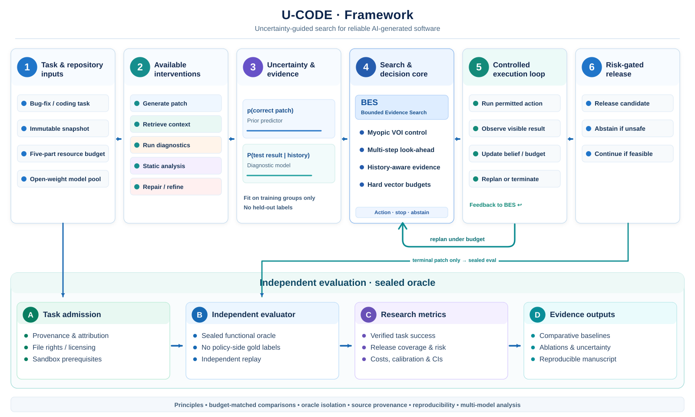

# U-CODE

**Uncertainty-Guided Search for Reliable AI-Generated Software**

[](https://github.com/Rocky5502/U-CODE/actions/workflows/ci.yml)
[](LICENSE)
[](pyproject.toml)
[](docs/RESEARCH_PROTOCOL.md)

> **Research prototype — not a validated repair agent.** U-CODE studies whether an LLM coding agent should **generate/repair another candidate** or **acquire additional correlated evidence** about candidates, then **release or abstain**, under independently constrained resources. No measured real-task U-CODE improvement, task admission, risk guarantee or six-model benchmark is claimed.

**Target venue:** Springer *Automated Software Engineering*, special issue
[Search-Based Software Engineering in the Era of LLMs and Agentic Systems](https://link.springer.com/collections/jjcfecffai)
(submission deadline **30 January 2027**, subject to publisher updates).

**Research progress (3 November 2026):** [source-audited checkpoint, readiness denominators and priority gates](docs/UCODE_RESEARCH_PROGRESS_2026-11-03.md) · [verified belief-history replay](docs/MCEA_HISTORY_REPLAY_BOUNDARY_2026-10-31.md).

**Research handoff (7 November 2026):** [V5 current new-chat master prompt and all R0–R16 roles](docs/UCODE_NEW_CHAT_MASTER_HANDOFF_V5_2026-11-07.md) · [V4 historical scientific charter](docs/UCODE_NEW_CHAT_MASTER_HANDOFF_V4_2026-10-29.md) ·
[Scientific blockers](configs/ucode_work_remaining_gates_2026-10-27.json) ·
[Springer source-era/novelty audit](docs/SPRINGER_V4_SOURCE_ERA_AND_NOVELTY_AUDIT_2026-10-29.md).

**Go #43 qualification and new-chat continuity:** [V5 activation](docs/UCODE_NEW_CHAT_MASTER_HANDOFF_V5_2026-11-07.md) summarizes PR #53, the verified [post-merge 1,515-test-per-Python-version CI](https://github.com/Rocky5502/U-CODE/actions/runs/42368901886), twelve prospective Go review case families and the **still-pending 16/16 PHP/Go admission gates**. These are first-party verification counts, not independently executable benchmark results. The V4 document remains immutable in its historical baseline statements; V5 is the current prompt. Validate its source-only contract with `python -m scripts.validate_v5_handoff`.

## Verified progress and remaining-work critical path (7 November 2026)

The latest [source-linked research-progress audit](docs/UCODE_PROGRESS_CRITICAL_PATH_2026-11-07.md)
separates completed **engineering preparation** from unverified
**publication-critical scientific exit conditions**. Its
[reproducible offline generator](scripts/export_critical_path.py)
crosschecks the two PHP/Go pilot preflight dossiers, selected six-model
manifest, registered eight-policy primary comparison, historical
ten-workstream plan, and frozen PR-discovery denominators. GitHub CI
publishes JSON, Markdown and SHA256 integrity files under
`ucode-research-critical-path-NO-EMPIRICAL-RESULTS-v1`.

**Remaining: 10/10 full major scientific exit criteria have no complete
independent qualification**, including **four P0**, five P1 and one P2.
This is **not** “0% of the software finished”: source code, mathematics,
unit tests and reviewer tools exist and are progressing. What is still
missing is external task rights/spec/oracle admission, physical sandbox
and model qualification, end-to-end matched empirical evaluation,
and final compiled/publisher-verified results. The two reviewed pilot
leads still have 16/16 open admission checks; 0/6 model checkpoints
and 0/8 real-policy arms are scientifically qualified.

The report deliberately does **not** invent a percent-complete,
calendar-time estimate, real task accuracy, measured risk, or
independent human approvals. It also validates that no prospective
protocol or model registry has been silently promoted into a real trial.

## At a glance

| Area | Source-verified scope (29 October 2026) | Important limit |
|---|---|---|
| Discovery | **120** distinct PR/repository-name leads; **119** retrieved metadata records | Not 120 runnable repositories |
| Language coverage | **12 search-language strata** | Actual changed-code language remains to be independently qualified |
| Screening | **62** production-source-path leads; **12** prioritized manual-review leads | Not 62 or 12 approved executable tasks |
| Real evaluation | **0** independently admitted executable tasks; **0** sealed functional oracles | Correctness, calibrated risk and causal effectiveness all **N/A** |
| Models | **6** selected open-weight model IDs | No weights/revisions/runtime/terms fully verified for this project |
| Policies | **8** preregistered arms | Only restricted first-party synthetic references, not eight faithful real runs |
| Runner | OCI launch-command **dry-run** and accounting interfaces | No independently attested isolation or five-resource physical meters |
| Offline tests | Python **3.10 / 3.12** GitHub Actions | First-party checks, not third-party software executions |

The two source-era PHP/Go pilot dossiers have **16/16 gates currently PENDING**;
neither candidate is an admitted executable task. Independent source-era
specification, rights, sealed oracle and sandbox evidence are still required.

At the **3 November 2026 `main` merge commit `92810cf`**, [GitHub Actions](https://github.com/Rocky5502/U-CODE/actions/runs/41595339193) passed **1,323 offline tests on each of Python 3.10 and 3.12**; first-party/synthetic checks do not constitute real-task validation. **Inspect the latest [CI](https://github.com/Rocky5502/U-CODE/actions)** after subsequent commits for new counts and outcomes.

## Task-scoped evaluator-oracle integrity (3 November 2026)

The [evaluator consistency audit](docs/EVALUATOR_TASK_ORACLE_CONSISTENCY_2026-11-03.md)
now rejects policy comparisons that silently substitute different evaluator
oracle artifacts for the same task, even when individual verdicts correctly
reference their released patches. It also rejects conflicting correctness
labels for the identical task/patch under one declared deterministic oracle.
Synthetic tests cover cross-policy, cross-model and cross-seed substitutions.

A separate [declared frozen oracle manifest](docs/FROZEN_TASK_ORACLE_MANIFEST_2026-11-03.md)
can additionally bind each task—including tasks where all policies abstain—to
one expected evaluator artifact digest *independently of the batch of verdicts*.
Postterminal and attrition audits reject any mismatch. The manifest is **only
an offline declaration**, not a trusted timestamp, human signature or real
pre-outcome oracle attestation. Actual independent source, test and sandbox
verification remain required. Qualified external tasks remain **zero**.

## G5-to-M4 real-source pilot activation preflight (6 November 2026)

The PHP/Go candidate leads have a new **offline cross-ledger admission
preflight** that validates their immutable PR identities, original changed
source/test files, source-era specification observations, evaluator-only
registration, and exact six-model/eight-policy study metadata. It refuses
unapproved execution, fictional sealed oracles, fabricated inference runs,
silent ninth-policy amendments, altered checkpoint claims, and result-table
values. There are **two public source leads, sixteen pending admission
gates, zero independently runnable tasks, and zero real-model outcomes**.

- [Activation and independent reviewer handoff](docs/G5_M4_REAL_PILOT_ACTIVATION_2026-11-06.md)
- `src/ucode/pilot_preflight.py`, `scripts/compile_pilot_preflight.py`,
  `tests/test_pilot_preflight.py`

From the repository root, run:

```bash
python -m scripts.compile_pilot_preflight
python -m scripts.compile_pilot_preflight --require-ready
# Strict mode deliberately exits with status 2 because the pilot is blocked.
```

The [Springer/Overleaf-tracked manuscript](paper/overleaf/main.tex) now
contains the public-only activation protocol and an explicitly *nonempirical*
PHP/Go gate-status table. This updates the **GitHub manuscript source**,
not a separate live Overleaf cloud project; compilation and an
independently verified execution runner remain separate steps.

## First Go pilot qualification: two original requirements documents (7 November 2026)

A new [Go #43 source-era independent-review handoff](docs/G5_GO43_SOURCE_ERA_ORACLE_REVIEW_2026-11-07.md)
pins **two** Git blobs from the *same pre-fix commit/tree*:

- `docs/design.md` — 16,052 original bytes, Git object
  `b566ca7627b6518670a866a6a637bd5257e947f4`.
- `docs/淮安80分业务规则.md` — 17,069 original bytes, Git
  object `e71288e3127cb66f2471a5ddd2800092db0552cc`.
  The design document explicitly defers to these business rules
  when conflicts arise.

The [public question blueprint](data/admission/2026-11-07/go43_pre_fix_oracle_review_blueprint_PUBLIC_NO_GOLD.json)
contains **12 original-section-linked proposed oracle coverage families**
and **six unresolved human-review questions**, including a real
conflict between zero-floor player balances and conservation of points,
plus underspecified fractional hall-multiplier rounding. We **do not**
choose convenient outputs from the post-fix PR.

[Typed verifier](src/ucode/go43_oracle_review_blueprint.py),
[optional local raw-byte Git blob checker/CLI](scripts/compile_go43_review_handoff.py)
and synthetic [regression tests](tests/test_go43_oracle_review_blueprint.py)
fail closed on wrong source versions, missing business rules, inserted
golds, or claimed approval. CI exports only source IDs and question
categories: never original source contents, hidden tests, private
reviewer forms, runnable Go binaries or model outcomes.

**Still NOT executable:** Go issue #29 was created only eight seconds
before PR #30 and its short issue wording was never independently
archived at PR creation. Both original task documents require
independent **scope/normativity** decisions, file-rights review,
an evaluator-only sealed oracle and a trusted sandbox. Go's eight
admission gates (and PHP's eight) remain pending. The registered
six-model/eight-policy comparison is unchanged.

## Go #43 formal specification feasibility questions (8 November 2026)

The [source-era Go settlement decision packet](docs/G5_GO43_SPEC_FEASIBILITY_DECISION_PACKET_2026-11-08.md) now contains an **exact-rational conditional witness** showing why fixed winner credits plus capped loser deductions cannot conserve total points for an underfunded toy case, together with a `5 × 1.5 = 7.5` hypothetical fractional-point example. Neither example is an expected oracle answer nor an imposed business rule. A source-pinned dependency map ties all **six unresolved independent reviewer decisions** to the **12 prospective test families**, without claiming approval. [Offline exporter](scripts/export_go43_spec_feasibility.py) and [adversarial checks](tests/test_go43_spec_feasibility.py) fail closed on fake task admission and gold injection; CI confirms the strict spec-ready gate still exits 2. Go/PHP admission remains **16/16 pending**, with no source execution or real-model experiment.

## Go #43 independent human-rule review: private paired triage (8 November 2026)

The [private Go domain-decision protocol](docs/G5_GO43_PRIVATE_RULE_ADJUDICATION_PROTOCOL_2026-11-08.md)
introduces a local-only, six-question two-reviewer worksheet and redacted
comparison of **unverified reviewer-supplied claims**. It distinguishes pending,
divergent verdicts, mismatched rule-memo digests, differing source references,
mutual scope rejection, and only *unadjudicated* agreement. This is a
source-bound reviewer workflow **not an actual review**; no human identity,
interpretation or hidden oracle has been authenticated. A future operator
must store completed private worksheets **outside the public repository**.
[Review CLI](scripts/triage_go43_domain_decisions.py) defaults to all six
**PENDING**; `--require-adjudicated` strictly exits **2**.
[Adversarial tests](tests/test_go43_domain_decision_triage.py) use fictional
private inputs only, and CI runs the public blank-form mode without
handling actual reviewer data. PHP/Go admission remains **16/16 pending**,
with **zero** independently executable tasks.

## P0-3 six-model public card and memory audit (9 November 2026)

A [read-only public model-card audit](docs/P0_3_PUBLIC_SIX_MODEL_CARD_AUDIT_2026-11-09.md) now compares all six exact selected Hugging Face model IDs against the unchanged October registration, lists the **public** license/gated tags, and computes approximate **BF16 weights-only** storage needs under a hypothetical 16 GiB memory scenario. The historical DeepSeek planning label (deepseek-license) differs from its observed Hub license tag (other); neither is a reviewed legal license. CodeGemma and Llama are publicly gated, not verified accessible to the study account. Neither card labels nor rough storage estimates establish weights, terms, runtime feasibility, inference measurements or permission to use third-party tasks. The [offline CLI](scripts/audit_six_public_model_cards.py), [bounded observation file](data/admission/2026-11-09/six_model_public_hub_cards_OBSERVATION_ONLY.json) and [adversarial tests](tests/test_public_model_card_audit.py) keep **0/6** models independently qualified; the strict CLI deliberately exits 2. This is P0-3 documentation/engineering only, not model inference or a completed milestone.

## Phase-0 before REAL U-CODE experiments: local hardware + matched-budget planning (8 November 2026)

The [real-experiment operator runbook](docs/REAL_EXPERIMENT_PHASE0_OPERATOR_RUNBOOK_2026-11-08.md)
now separates **permissioned first-party model/host smoke** from **independently
qualified third-party task evaluation**. A new
[read-only phase-0 CLI](scripts/prepare_real_experiment_phase0.py)
cross-checks the frozen six-model, eight-policy, five-resource study against
the blocked local preflight, all 13 public dataset leads and the PHP/Go
pilot ledger. It never makes a task runnable and does not download weights,
run code, start inference or import oracles:

```bash
python -m scripts.prepare_real_experiment_phase0
python -m scripts.prepare_real_experiment_phase0 --hypothetical-tasks 1 --hypothetical-seeds 3
python -m scripts.prepare_real_experiment_phase0 --require-real-ready # must exit 2
# Only on your OWN intended machine: optional read-only inventory
python -m scripts.prepare_real_experiment_phase0 --probe-gpu
```

The GPU survey uses an opt-in, bounded `nvidia-smi` query for only name,
VRAM and driver version; local telemetry is NOT an independent security
attestation and CI never probes hardware. The *unfrozen illustrative*
30k-token/20-test/3600 GPU-second/1800 CPU-second/3600 wall-second caps
imply a **48-arm, 1.44M-token, 48 GPU-hour summed ceiling** for one
hypothetical task × six models × eight policies × one illustrative seed,
but **not** actual compute requirements or a qualified task. Three
illustrative seeds give 144 slots and a 144 GPU-hour summed ceiling.
[Tests](tests/test_real_trial_phase0.py) check budget overflow/drift,
forged approval, host-input hygiene and no unintended execution.

**Real trial remains blocked:** no Go/PHP source-era task admission
(16/16 outstanding), no sealed oracle, no measured six-model load,
no authenticated sandbox/meters and no faithful eight-policy end-to-end
evidence. Do **not** report synthetic examples as real improvements or
treat the optional `--probe-gpu` as permission to rent GPUs.

## All thirteen dataset sources + research code readiness (7 November 2026)

The [full source-by-source and code-readiness review](docs/ALL_DATASETS_AND_CODE_READINESS_2026-11-07.md)
crosschecks the **13 external dataset leads**, the frozen **120-PR
metadata cohort**, the real PHP/Go **16 pending admission gates**,
all six model-readiness declarations, the authoritative **eight
policy/five-resource** study, and ten representative first-party
code/test component groups.

- [Deterministic audit/export CLI](scripts/audit_all_dataset_readiness.py)
  and [typed audit implementation](src/ucode/dataset_code_readiness.py)
  produce `ALL_DATASET_READINESS.json`, `ALL_DATASET_CODE_STATUS.md`
  and a separate SHA256 receipt under the GitHub Actions artifact
  `ucode-all-13-datasets-code-readiness-NO-REAL-TASKS-v1`.
- [Adversarial audit tests](tests/test_all_dataset_code_readiness.py)
  reject duplicate/missing source entries, forged task admission,
  fake model inference or oracle approvals, and altered trial policy
  identities.
- **Important configuration repair:** `configs/experiment_matrix.json`
  still contains a historical seven-arm/four-resource sketch, now
  explicitly marked **non-authoritative and non-executable**.
  The scientific registration remains
  [six models, eight policies and five caps](configs/confirmatory_sbse_protocol_2026-10-25.json).
  No preregistered hypothesis, model slot or primary contrast was changed.

The full first-party CI validates code contracts; **no external
dataset has been independently acquired, file-rights-approved,
oracle-sealed or executed within U-CODE**. The original 120-PR
metadata release is reproducible but is **not** a code-repair
benchmark. No 13-source download, 12-language runnable dataset or
real treatment effect is claimed. The source audit is *not* a local
disk scan or a whole-repository security audit.

## M8 offline evidence-signature integrity and Springer source update (7 November 2026)

The private independent reviewer workflow now has a
[domain-separated Ed25519 receipt checker](src/ucode/external_admission_receipt.py)
and a [strict local-only verification CLI](scripts/check_external_review_receipts.py).
The tool binds signed claims to a specific original PHP/Go source-era task,
its pre-fix base/declared scope, reviewer-only specification, rights,
hidden-oracle commitment, independent lineage split, OCI image, toolchain
and five-resource meter profile. It rejects missing/duplicate A/B
reviewer slots, role mismatches, aliased verifier keys, expired or invalid
signatures and mismatched binding hashes. The signing scheme is standard
Ed25519, **not** an independently novel algorithm.

**Signature-valid is not admitted.** Even 16 perfectly matching signed
synthetic claims leave `scientific_task_admitted: false` and
`external_code_execution_authorized: false`. The externally approved
key policy, the real human reviewers, file rights, oracle and runner
attestation **have not** been independently authenticated. Do not copy
private reviewer forms, verification keys, detached signatures or hidden
oracles into this repository or CI.

The Springer [main.tex](paper/overleaf/main.tex) methods and
[references.bib](paper/overleaf/references.bib) include the conservative
signature/immutable-binding protocol and authoritative RFC 8032 citation;
the CI `ucode-overleaf-sources` ZIP contains the latest **GitHub source**
(not a live Overleaf cloud sync or compiled publisher PDF).

[Full code, reviewer handoff and limitations](docs/G5_SIGNED_EXTERNAL_EVIDENCE_CONTRACT_2026-11-07.md).

## G5 reviewer evidence triage: private A/B handoff (7 November 2026)

The frozen **12-candidate × 8-gate × 2-reviewer** inventory has a new
**local-only completed-form audit**. It checks every filled A/B JSONL row
against canonical public PR/candidate metadata and rejects unknown
approval fields, wrong reviewer slots, duplicate JSON keys,
malformed data, missing records and evidence-content/references
mismatches. Previously two positive reviewer verdicts counted as
agreement even if they pointed to different evidence digests;
these now produce an **unresolved reconciliation status**.

- [Private reviewer handoff, protocol and science boundaries](docs/G5_PRIVATE_REVIEW_TRIAGE_2026-11-07.md)
- [Redacted offline audit CLI](scripts/audit_private_review_forms.py)
- [Completed-form discrepancy logic](src/ucode/reviewer_adjudication.py)
- [Synthetic adversarial privacy and non-admission tests](tests/test_private_review_inbox.py)

**Never commit, upload or pass real completed reviewer forms to public
CI or agent prompts.** The local command emits a redacted, source-ID
and gate-only status report—not identities, reviewer free text,
evidence URIs or content hashes. Even **96/96 matching positive
reviewer claims do not admit any task**; independent source-era
specification adjudication, rights, sealed evaluator and authenticated
sandbox approval remain separate blocking steps. This new module
does **not** contain actual independent human reviews.

## M4 code review and provenance hardening (7 November 2026)

A focused [code review](docs/M4_JOINT_CODE_REVIEW_2026-11-07.md)
of the joint-frequency fitter and same-marginal acquisition controllers
identified three consequential scientific-validity risks. These are
now fixed and covered by independent regression cases:

- **Candidate-data leakage:** prevent duplicate candidate proposal IDs
  and duplicate public pre-outcome snapshots under different task IDs;
  reject task/proposal/snapshot reuse across train and validation.
- **Mixed model revisions:** require an explicitly declared lower-case
  SHA256 **checkpoint identity** on each row, frozen predictor and
  candidate comparison; reject competing fits within the same
  frozen model/action/context.
- **Repository-size domination in reported validation:** retain
  task-micro Brier/log/marginal scores but additionally report
  separately named **equal-lineage macro scores** and group-level
  absolute marginal prevalence gaps.

Hash strings and model timestamps are **not** independent authenticators.
No real benchmark trial or trusted external checkpoint is unlocked by
these safeguards. The registered six models, eight policies and the
unchanged intention-to-treat primary comparison remain prospective.

## M4 next-stage: lineage-disjoint fitted-joint control (7 November 2026)

A new **training-only, context-bucket-conditional eight-outcome frequency
baseline** makes our DRPA research more falsifiable. The implementation
checks pre-outcome feature timestamps and immutable source group splits,
forbids validation/evaluation labels from fitting, enforces one prospectively
selected candidate per task, and requires at least two training lineages
supporting *each outcome class* of reliability, safety and candidate validity.
Its eight cell probabilities are group-balanced so a single large
repository cannot automatically dominate the fit. Separate validation-only
Brier and log scores do not modify the trained model or grant risk guarantees.

A same-marginal comparison now evaluates **four** acquisition rules on
identical proposed patches, fixed predicted marginals, objectives, prices and
**all five hard resource caps**: fully independent expected HVI, old two-way
robust DRPA, three-way robust DRPA, and a fitted joint-frequency
expectation. It refuses mismatched model/protocol identities or forecast
marginals rather than making unfair performance claims.

- [Formal train-only baseline, equations and incomplete-label caveat](docs/M4_TRAIN_ONLY_JOINT_FREQUENCY_CONTROLS_2026-11-07.md)
- [Joint-frequency fitting and validation](src/ucode/joint_frequency_fit.py)
- [Matched four-way source-only controls](src/ucode/joint_frequency_controls.py)
- [Synthetic-only end-to-end demonstration](scripts/smoke_joint_frequency_controls.py)
- [Adversarial integration tests](tests/test_joint_frequency_controls.py)

**Important:** this is a deliberately **simple categorical joint-frequency
control, not a state-of-the-art fitted neural joint model**. Every training
row in CI is invented; **no independently authenticated repository-task
training labels exist yet**. It establishes fairness and leakage
engineering, not model performance, a strong new benchmark, or an
additional registered confirmatory policy. The six selected model
identities, eight registered arms and unchanged primary outcome remain
prospective; external G5 pilot admission and genuine independent
calibration/security assessment are still blocking.

## M4 extension: three-way validity-aware DRPA (7 November 2026)

The original candidate-producing DRPA reference handled uncertain dependence
between predicted reliability and safety, but **assumed candidate validity was
independent** of both. The new `src/ucode/joint_validity_acquisition.py` removes
this additional unverified assumption in a **bounded binary model**. It
enumerates at most 70 rational coupling bases for the exact sharp range of
new-patch HVI under fixed reliability, safety and validity marginals, and
then chooses a worst-case-positive `generate`/`repair` action within all five
hard resource limits—or **STOP**. An independent 125-case triple-intersection
test, witness mass checks, and adversarial action/assumption tests guard the
mathematics.

- [Three-way mathematical specification, limitations and falsifiers](docs/THREE_WAY_VALIDITY_COUPLING_2026-11-07.md)
- [Implementation](src/ucode/joint_validity_acquisition.py)
- [Independent reference tests](tests/test_joint_validity_acquisition.py)
- [Updated prior-work/novelty matrix](literature/DRPA_NOVELTY_MATRIX_2026-11-06.md)

**Evidence boundary:** this is **not** a statistically calibrated improvement,
a verified software-security result, a population risk certificate, a real
PHP/Go task run, or an added ninth registered policy. The registered
six-model/eight-policy design and all G5 admission blockers are unchanged.
A well-fit three-way joint model can outperform this conservative reference.

## Exploratory DRPA algorithm and novelty audit (6 November 2026)

A new **Dependence-Robust Pareto Acquisition (DRPA)** reference now bounds
two-objective candidate hypervolume improvement without assuming reliability
and safety marginal forecasts are independent. For **two-point marginal
outcomes**, it evaluates both exact Frechet-compatible coupling extremes,
uses all five resource caps, and can **STOP** when no robustly positive
candidate-producing action exists. An independent Fraction-based grid oracle
crosschecks the synthetic acquisition math. Diagnostics still use evidence
value, never a fabricated new Pareto point.

- [Algorithm, equations, synthetic ranking reversal and limitations](docs/DRPA_DEPENDENCE_ROBUST_ACQUISITION_2026-11-06.md)
- [Recent-prior-art novelty and proposed ablation matrix](literature/DRPA_NOVELTY_MATRIX_2026-11-06.md)
- `src/ucode/dependence_robust_acquisition.py` and `tests/test_dependence_robust_acquisition.py`

**Research boundary:** an exploratory M4 mathematical ablation, **not**
a validated new contribution, trained joint distribution, ninth registered
policy, measured risk guarantee or real multi-model experiment. The
independence of candidate validity and objective quality is an explicit
untested assumption; model-conditional bounds cannot replace true held-out
evaluation. The six-model/eight-policy study configuration is unchanged.

## MCEA observability: can verification resolve the uncertainty? (30 October 2026)

The new [finite-horizon observability and coupling audit](docs/MCEA_FINITE_OBSERVABILITY_AND_COUPLING_AUDIT_2026-10-30.md)
tests whether two latent explanations (diagnostic-reliability model
and patch acceptability) can be distinguished by ANY feasible sequence
of the currently registered diagnostics. Its bounded search respects
globally single-use actions, hard five-resource limits and frozen
history-conditional evidence models.

If every shared reachable history yields the same binary likelihood
under both explanations, no admissible diagnostic sequence can
distinguish them within the stated model. For near-identical models,
a conservative transcript total-variation bound gives a conditional
two-explanation classification-error lower bound. An independent
exact-rational two-probe reference checks 27 parameterized model/horizon
settings. These are **synthetic identifiability and mathematical
validation tests**, not independent software-repair experiments.

**Integrity correction:** MCEA's posterior now stores complete,
versioned likelihood-kernel fingerprints. Replacing a diagnostic
model under its old scenario ID between visible evidence observations
fails closed; reordered but identical likelihood rows retain the
same digest. Those hashes do not attest that the frozen probabilities
were learned correctly.

```bash
python -m unittest discover -s tests -p 'test_finite_observability_audit.py' -v
python -m unittest discover -s tests -p 'test_observability_coupling_bound.py' -v
```

## Novelty candidate: model-coherent evidence acquisition (30 October 2026)

We added a new **two-level Bayesian diagnostic search reference** that
models uncertainty about a patch's correctness **and** uncertainty about
which frozen evidence-reliability model is generating the test results.
Its joint posterior is updated only through visible diagnostic outcomes;
the same hidden model identity persists across all observations. The
planner allocates tests/retrieval/static analysis under the existing
five hard resource caps and supports pooled-risk or all-surviving-model
release gates.

An [independent rational mathematical audit](docs/COHERENT_HYPOTHESIS_EVIDENCE_SEARCH_NOVELTY_2026-10-30.md)
includes a counterexample: a perfect-versus-inverted diagnostic appears
valuable when each hypothetical reliability model is treated as known,
but cannot help at one step when its meaning is truly unknown. A
calibration-then-diagnostic sequence has stipulated two-step net value
**0.48**. Twenty additional exact-rational configurations and
adversarial code tests check the restricted method.

**Scope:** first-party synthetic algorithm only; not a fitted model,
newly established theorem, real-task experiment, or measured software
repair improvement. The original six RQs and eight planned policy arms
are unchanged until a separate prospective protocol revision.

```bash
python -m unittest discover -s tests -p 'test_coherent_hypothesis_search.py' -v
```

## First real-task provenance gate: pinned Go source-era specification file (30 October 2026)

The [source-era Go #43 document binding audit](docs/GO43_PRE_FIX_DOCUMENT_GIT_TREE_BINDING_2026-10-30.md)
now cross-checks the registered pre-fix design document against the
actual immutable Git base-tree entry observed through read-only GitHub
metadata. It requires the exact `docs/design.md` path, base commit, Git
tree, blob SHA, regular-file mode and file size; wrong document links
or plausible-looking but unrelated SHA40 values fail the evaluator
registration audit. The historical PHP #104 issue remains quarantined:
its current body is not a frozen historical pre-PR specification.

This closes an important *source-identity* control gap without
promoting either lead to experiment eligibility. File-level rights,
independent behavior review, sealed tests, authenticated sandbox and
five-resource enforcement are still absent; **qualified tasks remain 0**.

```bash
python -m scripts.check_evaluator_boundary
python -m unittest discover -s tests -p 'test_pre_fix_spec_binding.py' -v
```

## Whole-archive Bellman search: independent mathematical cross-validation (30 October 2026)

A new [exact-rational joint-search audit](docs/INDEPENDENT_JOINT_BELLMAN_RATIONAL_AUDIT_2026-10-30.md)
compares both finite-horizon, candidate-aware Bayesian controllers against
an independent `fractions.Fraction` reference enumerator. The standalone
reference enumerates latent candidate-truth vectors and every binary
diagnostic outcome without calling either planner's Bayes updater or
terminal-value helper. It checks **205 authored mathematical model
configurations**: 144 independent candidate-prior configurations, 36
correlated-prior configurations, one zero-probability edge case, and
24 mixed generation/verification cases with optional incumbent release.

The tests target globally single-use diagnostics, exact branchwise
posterior value, generation failure, surviving archived candidates and
correct placement of action costs. **These are synthetic calculations,
not 205 approved repository tasks or measured LLM performance**. The
paper's Methods describe the checks, with no claim of real effectiveness.

## Training-only Bayesian diagnostics: lineage-support and hash hardening (29 October 2026)

A [new scientific validity audit](docs/CLASS_CONDITIONAL_LINEAGE_SUPPORT_AUDIT_2026-10-29.md)
closes a gap in the diagnostic likelihood estimators. Requiring two
repository/fork lineages *overall* cannot establish class-specific support
when one source group supplies only acceptable cases and another only
unacceptable ones. The conditional estimator now checks **at least
two training lineages per class per observed action/history cell**;
the unconditional estimator applies the same principle per
correctness class. Sparse or source-confounded estimates fail closed.

Both fitters also use versioned structured input fingerprints instead
of ambiguous delimiter-concatenated identifiers. The source-only
regressions and proposed Springer Methods are updated. **These changes
do not establish empirical calibration or real model correctness**;
independent task admission and held-out lineage validation remain blocked.

## Corrected archive-conditional Bayesian value of information (29 October 2026)

The [incumbent-preserving Bellman audit](docs/CONDITIONAL_ARCHIVE_INCUMBENT_BELLMAN_FIX_2026-10-29.md)
fixes a **scientific planning bug**: the conditional archive had
computed `max(E[posterior patch utility], other-patch utility)` rather
than preserving the best unchanged archive candidate at **each
diagnostic outcome**. It now computes the correct
`E[max(posterior patch utility, other-patch utility)]`
under the finite per-patch kernel assumptions. A separate exact-rational
oracle checks 1,152 hypothetical one-step cases, alongside tested
positive/negative release-branch outcomes and five-resource budgets.
The prospective manuscript Method section now discloses this fix.

An illustrative **synthetic** two-candidate counterexample has
stop utility `0.84` and corrected expected diagnostic value `0.91`.
These are **not model inference or real code-repair results** and do
not support a performance claim.

## First prospective task contract and evaluator-boundary hardening (29 October 2026)

The [new prospective PHP #104 review contract](docs/NEW_PROSPECTIVE_PHP_TASK_BOUNDARY_AUDIT_2026-10-29.md)
is now separately identified from the **unverified historical PR task**.
Its proposal is linked to the original base-source Git blob inventory,
but it has **no independent reviewer approval, private oracle, license
clearance, isolated runner or experimental authorization**. CI validates
the public source crosswalk and rejects fabricated approval fields.
We also fixed cross-repository GitHub issue-reference substitution and
unsafe Unicode control characters in policy-visible task views.

```bash
python -m scripts.validate_php104_prospective_draft
```

## Executable first-party repair canary (29 October 2026)

The [first-party executable canary and real-task admission report](docs/FIRST_PARTY_EXECUTABLE_CANARY_AND_REAL_TASK_GATE_2026-10-29.md)
now exercises **actual trusted Python code** for two frozen public repair
alternatives. The intentionally faulty fixture passes **4/7** and the
corrected fixture **7/7** public cases; an independent seal, real
repository task, LLM run and physically isolated sandbox are **not**
claimed. The first-party subprocess smoke runs in CI.

```bash
python -m scripts.smoke_first_party_executable_canary
```

An optional [operator-only local rootless Docker probe](scripts/probe_local_oci_first_party.py)
can validate a pre-reviewed, locally cached digest-pinned image with a
fixed first-party print fixture. It is **not** called by CI; it cannot
execute external repository tasks or grant real-study approval.

## Ten senior SE/AI research perspective audit (29 October 2026)

The [ten-perspective source-code audit](docs/TEN_SENIOR_SE_AI_CODE_REVIEW_2026-10-29.md)
documents concrete fixes to fork-lineage statistical grouping, metadata
source validation, scalar-cost overflow and tiny-resource ledger reconciliation.
It also distinguishes unimplemented experimental infrastructure from
first-party passing tests. These are ten analytical disciplinary reviews,
**not ten independent human researchers or proof of real-task performance**.

## Independent mathematical and 1,000-perspective review (29 October 2026)

The [new source-grounded research audit](docs/RESEARCH_1000_PERSPECTIVE_MATH_DATA_AUDIT_2026-10-29.md)
provides an independent exact-rational cross-check of Bayesian posterior,
bounded two-step evidence search and infrastructure-missingness equations;
a strict 120-PR/13-source dataset crosswalk; and a repair to malformed
Springer citation syntax. Its [1,000-perspective review register](scripts/export_1000_research_lenses.py)
is **20 scientific domains × 10 risks × 5 review roles**, all **PENDING**:
it does not claim a thousand independent reviewers or completed experiments.

```bash
python -m scripts.audit_dataset_cohort_crosswalk
python -m scripts.export_1000_research_lenses
python -m scripts.audit_overleaf_sources
python -m unittest discover -s tests -v
```

All math and dataset checks are **source-only/synthetic** and leave the
first real executable task admission and hidden oracle **blocked**.

## Framework



*Figure 1. Architectural design, not a completed or validated experimental result.* The evaluator-only oracle must never be passed to the policy, model prompts, retrieval context or uncertainty estimators.

The primary confirmatory comparison is **conditional evidence-search U-CODE vs equal-budget no-uncertainty search**, keeping the task/model/seed/public proposal opportunities and all five caps matched (tokens, test calls, GPU seconds, CPU seconds, wall seconds). Other registered arms include unconditional evidence search, uncertainty-only, fixed testing, selective verification, MCTS and replay-based search; implementation fidelity is not yet established.

## Quickstart: safe, offline, first-party checks

Python **3.10 or 3.12** is used in CI. From a cloned repository:

```bash
git clone https://github.com/Rocky5502/U-CODE.git
cd U-CODE
python -m venv .venv
# Linux/macOS: source .venv/bin/activate
# Windows PowerShell: .venv\Scripts\Activate.ps1
python -m pip install -r requirements.txt
python -m unittest discover -s tests -v
python -m scripts.check_local_readiness
```

The default package has **no third-party runtime Python dependencies**.
`requirements.txt` installs this package in editable mode; optional model
engines, PyTorch, Docker/Podman, GPU drivers, benchmark toolchains and upstream
datasets are **not** silently installed. Do not run external repositories on
the host or GitHub Actions. Local inference is an **explicit, separately
reviewed** step after the [local experiment gates](docs/LOCAL_EXPERIMENTS.md).

Useful reproducible, *offline metadata-only* commands:

```bash
python -m scripts.validate_sbse_protocol
python -m scripts.audit_six_model_crosswalk
python -m scripts.audit_dataset_quality --output-dir dist/ucode-pr-metadata-clean
python -m scripts.verify_dataset_release dist/ucode-pr-metadata-clean
python -m scripts.export_research_readiness --output-dir dist/ucode-research-readiness
python -m scripts.audit_overleaf_sources
```

These checks never download model weights or run third-party source code. Generated
outputs stay under ignored `dist/` paths.

## Model and dataset registry

The **authoritative, immutable-for-planning six-model roster** is
[`configs/accepted_six_model_study_2026-10-25.json`](configs/accepted_six_model_study_2026-10-25.json).
The prospective study contract is
[`configs/confirmatory_sbse_protocol_2026-10-25.json`](configs/confirmatory_sbse_protocol_2026-10-25.json).
The [six-model A100 planning profile](configs/ai_galaxy_six_model_deployment_2026-10-27.json)
is **configuration only**; it does not approve rental or claim compatibility.

**[Model matrix and per-model restrictions](docs/MODELS.md)** documents all six
Hugging Face IDs, advertised card licenses (not approved rights), tokenizer
and checkpoint freeze requirements, quantization/runtime caveats, and
hardware-dependent decisions.

**[Dataset catalog and readiness](docs/DATASETS.md)** distinguishes the
source-audited 120-PR metadata pool from the **13 external candidate sources**
in the V2 registry and from any independently executable task cohort.
[Curated dataset provenance](data/curated/README.md) explains the SHA-checked
eight-file metadata release. No external dataset weights, code trees, hidden
tests or model outputs are stored in this repository.

## Repository map

| Path | Purpose |
|---|---|
| `src/ucode/` | Formal search, reference controllers, provenance, policy/evaluator boundary and audit code |
| `configs/` | Frozen prospective study contract, selected model IDs, restricted deployment/experiment planning |
| `data/discovery/` | Source URLs, search leads and dataset candidate registries |
| `data/audits/` and `data/curated/` | Reproducible, source-free PR metadata and quality checks |
| `data/admission/` and `data/evaluation/` | **Pending**, evaluator-separated review metadata; never public hidden gold |
| `scripts/` | Offline validations, exports, readiness and synthetic smoke tests |
| `tests/` | Adversarial first-party offline unit tests (no untrusted source builds) |
| `paper/overleaf/` | Prospective Springer LaTeX and bibliography; not a verified compiled PDF |
| `docs/` | [Research handoff](docs/UCODE_NEW_CHAT_MASTER_HANDOFF_V4_2026-10-29.md), [experiment preparation](docs/LOCAL_EXPERIMENTS.md), [data rights](docs/DATA_GOVERNANCE.md), [scientific protocol](docs/RESEARCH_PROTOCOL.md) |
| `docs/README_RESEARCH_LOG_THROUGH_2026-10-29.md` | Complete preserved historical development log; dated snapshots not current eligibility |

## Scientific integrity, security and attribution

- **No fabricated accuracy:** neither a passing synthetic test nor a merged
  upstream PR is independent functional correctness evidence. The 120/120 links attempted, 119/120 PRs retrieved
  metadata screen yielded **zero fully eligible executable tasks**.
- **No oracle leakage:** post-fix patches, private labels and independently
  sealed evaluator fixtures never enter prompts or public policy observations.
- **No unsafe execution:** discovered repositories must first pass source rights,
  independent task admission, rootless/disposable network-off sandbox validation,
  and real five-resource enforcement. The present repo does not offer that runner.
- **No implicit rights:** MIT applies to **original U-CODE source** only. External
  repositories, datasets and model weights retain their own licenses and gated terms.
  See [LICENSE](LICENSE), [SECURITY.md](SECURITY.md),
  [model licenses](docs/MODELS.md), [data governance](docs/DATA_GOVERNANCE.md).
- **No unverified generalization:** naturalistic agent-attributed PR metadata,
  controlled model-generated patches, issue-repair datasets and attribution
  snippets are **distinct cohorts**; never pool them without an explicit design.

**Contributing:** [CONTRIBUTING.md](CONTRIBUTING.md) · **Security reports:** [SECURITY.md](SECURITY.md) ·
**Original project license:** [MIT](LICENSE) · **Citation:** [CITATION.cff](CITATION.cff) ·
**Canonical Springer manuscript:** [main.tex](paper/overleaf/main.tex).
